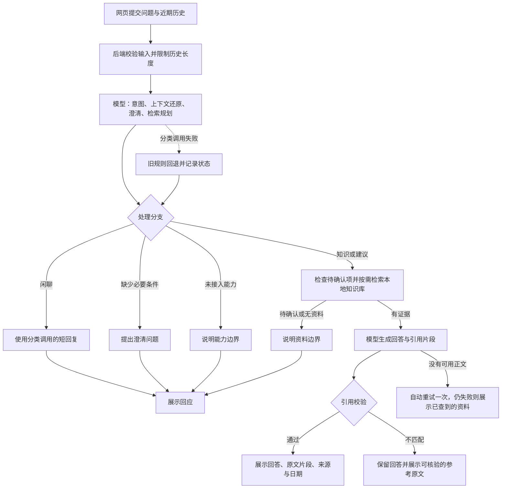

# 弈宝：设计与验证记录

更新：2026-10-14。对应当前向量检索版，按作业题六项交付要求组织。详细验收见 [项目梳理](project-audit.md)；历史实验不作为当前版本成绩。

## 1. 范围、运行与环境

单游戏《王者万象棋》、单原创向导“弈宝”，提供知识问答、情境建议、闲聊和能力边界说明。流程自行编排，依赖 FastAPI、Pydantic、httpx、FastEmbed 和 Qdrant，未接入 LangChain、Jev 或多 Agent 框架。没有账号、战绩和实时对局访问能力。

已验证 Windows / Python 3.11.5。安装 requirements-dev.txt，首次从 .env.example 创建 .env，填写后端 LLM_BASE_URL、LLM_API_KEY、LLM_MODEL；已有配置不要覆盖。完整命令见 [README](../README.md)，精确依赖见 requirements-lock.txt。

依次运行 `python -m scripts.index_knowledge` 和 `python -m uvicorn app.main:app --host 127.0.0.1 --port 8000`。首次索引联网下载嵌入模型，之后复用 data/models/ 与 data/vector/。原始知识随仓库提供，模型和数据库不提交。Qdrant 本地目录只允许一个进程占用，索引及独立评测前停止后端，服务保持单 worker。

用户已配置API，当前向量版已完成36例45轮真实运行及开发代理抽查；规则通过33/45，不能视为完整语义质量验收。Mock 仅作联调并明确标注；健康接口的配置齐全标志不保证模型服务可达。

## 2. 接口与流程

POST /api/chat 接收 message/history，经过输入校验→限制历史长度→模型一次完成意图、上下文还原、澄清判断和检索规划→按分支检索或直接回应→有证据时模型生成→引用原文校验。返回 answer、intent、status、sources、retrieved_ids、retrieval_plan、routing、model_calls、latency_ms、timings_ms、mode、model_used 和 request_id。网页及离线评测共用 Agent.chat。

意图模块独立可测：正常live由大模型同时判断四类意图、必要澄清和检索计划；范围外请求由分类模型在reply中按当前请求生成具体限制；混合请求在limitation中说明不支持部分，同时保留可回答游戏部分，检索未命中保持知识意图。旧规则只在Mock或模型分类失败时回退，响应明确记录。情境缺项由模型结合历史判断，不再强制匹配固定字段正则。详见 [本轮改造](agent-upgrade.md)。

历史最多24条、合计24000字，单条最多12000字。前端超限时淘汰最早完整轮次，后端不再二次缩为6000字。分类规划和回答生成均接收同一段按user/assistant角色排列的完整近期历史及本轮原始问题，由模型承接主题、列表和指代；不为某句追问加专门规则。历史助手文本可用于定位对象，事实仍以本轮检索原文为准。页面支持连续对话、清空、等待、失败重发和原文来源展示，会话仅在内存保存。

意图与规划在一次模型调用中完成；需要检索时输出查询、关键词、实体、模式和历史开关，结构允许最多4条，提示优先1条、复杂最多3条，向量执行最多3条（含还原问题）。结构合法不能保证语义正确。闲聊、范围外说明和澄清直接使用分类调用生成的文本，不再追加一次模型调用；知识生成接收本轮原始问题、相关证据以及与分类阶段相同的近期对话。

引用问题不阻断可读回答：短引文允许逐字引用，重复编号去重，不匹配/缺失片段改为展示已知来源的真实正文并标为reference，未知来源省略。没有可核验来源时正文仍显示并附简短说明；资料不足回答不挂引用。没有可读正文才最多自动重试一次，仍失败则展示检索资料，状态为partial_answer，generation_error保留原因。网络或配置异常也用普通对话提示，不显示红框。这里的“原文”是已入库记录的body；若记录是站方解释或整理文本，不能因此称为官网逐字原文。网页展示片段、来源链接、层级和日期，回答时不重新访问网站。当前没有逐句推论核验器，真实引文仍不等于支持所有结论。用户、历史、资料均按数据输入，客户端禁止system角色，网页使用textContent；这些措施不能证明完全抵抗提示注入。

## 3. 知识库设计

官网基础知识30条，Wiki片段7701条，合计7731条。按规则、对象字段、卡面效果、解释及公告等可引用单元组织，包含 ID、主题、正文、来源标题/链接、日期、版本范围、实体、模式、事实类型和核验层级。覆盖目标与资源、英雄、棋手、装备、天赋、机制、成就、钻石狂潮、攻略、公开阵容和更新记录等。

wzwxq.com 是本项目接受的知识来源，但网站收录原文、站方解释、工具模型和待确认项仍区分，不能全部称为官方核验。原始快照、覆盖记录和85个工具模型分片随工程保存。924项站内搜索对象有映射；全覆盖指已枚举公开快照，不含无法获取的动态社区阵容、私有分享或站外数据。详见 [知识说明](full-wiki.md)。

默认512维 BGE 中文嵌入与 Qdrant 本地库。长正文按350字符窗口、300字符步长嵌入，平均归一化为记录向量，正文完整保存在 payload。每个查询最多召回100个向量候选，补充明确实体，再结合词法、标题、别名和语义分数排序，多查询合并后最多取6条主体证据。建议类可另补最多2条触发机制定义，最终回答最多引用48条。清单问题由模型输出selection，按栏目、关联主题或对象名从Qdrant批量取回卡面原文及关联依据，最多24个对象，返回总数与本次覆盖数。多英雄购买优先覆盖费用及各英雄原文，证据充足时可直接按ID读取。平均向量可能稀释长文局部事实，证据数量也限制复杂问题覆盖。

向量检索主要使用模型还原的问题及查询句，不单独嵌入 keywords 关键词串；keywords/entities 保留在规划结构供展示及词法检索后端使用，向量实体补充从实际查询句提取名称。正常live中的还原问题由模型给出，提示要求保留实体、数字和条件，但没有硬性保证原始用户文本全部保留，仍可能发生错误改写。

按模式、核验状态、待确认和历史范围过滤。未知、待确认或版本未核验时说明资料边界。来源层级和日期有助识别冲突，但尚无通用矛盾检测、跨版本裁决和任意版本查询能力。

更新流程：抓取→解析归档→构建记录→检查覆盖和来源→停止后端→重新索引→回归检索与回答；支持从快照离线重建。源文件、模型和处理版本组成索引指纹，不匹配时拒绝旧库。向量化不会缩小原始资料；模型及数据库增加磁盘占用。并发或规模增长可迁移 Qdrant 服务端，当前不宣称已验证内存优化。

## 4. 离线评测与真实结果

固定集36例45轮，含四类意图、5组多轮、资料不足、澄清、能力限制、混合请求和用户注入。标签及评分规则只传评测器。运行 `python -m eval.run --mode live --output eval/reports/实验名` 输出逐轮、汇总及待人工复核记录；已更新钻石狂潮、等价证据和自然限制说明标签；详见[第5项要求核对](../eval/README.md)。

评分结合事实正则组、禁止断言、状态、引用，以及建议五维度：行动、条件、代价收益、调整条件、证据边界。建议至少8/10且关键维度通过。意图、回答、成功率分母为全部轮次；检索分母为预期知识非空轮次，Hit 为至少命中一项，Recall 为预期条目覆盖比例；成功、失败和评分耗时分开。规则通过率不是语义正确率，尚未采用模型评审。

| 已有证据 | 结果 | 边界 |
| --- | --- | --- |
| 历史真实模型 2026-10-13-live | 成功32/36，回答规则29/36，建议0/4；成功中位4.12秒、P95 7.10秒 | 旧检索与当时配置 |
| 当前向量 query-final.json | 检索10/10 | 实际嵌入和数据库，未调用规划或回答模型 |
| 当前 multi-hero.json | 费用与五位英雄资料均覆盖 | 不证明生成建议正确 |

向量报告见 eval/reports/2026-10-13-vector/。本次自动测试结果见项目梳理；模拟模型测试不能替代真实质量评测。历史提高预算后的另一实验仍有失败和很长的失败耗时，不能凭它宣称当前问题解决。

本轮已修正WX04钻石狂潮标签并登记已核对的等价证据组；尚未登记的等价表达和来源仍可能被误判。生成失败的阶段归因与调用计数已修正，旧报告保持原口径。向量模式的baseline/enhanced也不是原词法算法的纯对照。最新9例真实回归、耗时和引用结果见本轮改造报告，仍需修正全集标签并人工复核。

一次可复核改进：向量首次10例中9例命中，补充机制实体候选后达到10/10。用户反馈的详细追问、五英雄购买和输出截断问题也有回归测试。新增开发代理抽查记录，不冒充提交者逐条人工答案复核。

## 5. 效率与取舍

知识回答通常一次分类规划加一次生成；闲聊、能力限制和缺条件追问通常一次分类调用。当前DeepSeek默认启用额外思考，复用TLS配置和请求内连接。没有可用正文时最多自动重试一次，截断时重试预算翻倍（至少8192、最多32768 token），两次共用生成超时；仅引用问题在本地处理，不增加模型调用。默认分类规划4096 token、60秒，生成16384 token、120秒；超时是等待上限，不是正常耗时目标，也不是含排队和检索的严格全请求上限。

提供阶段耗时，嵌入在线程执行，复用索引并设置有界查询缓存。此前关闭额外思考的9个真实场景本机中位耗时为5.93秒，基础规则由改造前28.53秒降至7.73秒；之后补充触发定义的购买专项为6.62秒。样本及版本范围见 [本轮改造](agent-upgrade.md)，仍需扩大测量，未做并发压测。未全程计时，实际投入工时未记录，不能编造。范围保持单游戏 Demo，不增加账号、云部署、会话数据库或多 Agent。

## 6. AI开发与人工核验

Codex参与需求、资料、代码、测试、排错和文档；运行时使用配置的Chat Completions服务及本地BGE，历史报告保存当时模型名称，密钥不进入交付物。

用户亲自测试发现“讲详细点”丢失上下文和购买建议失败；开发代理检查调用与代码，修正上下文、截断及证据覆盖。用户反馈与代理修正分别署明，不能将代理检查冒充提交者亲自审查。提交前仍需人工检查基础事实、建议条件与数值、多轮、未知和注入样本，记录依据和结论，并补充可核实的投入时间说明。
